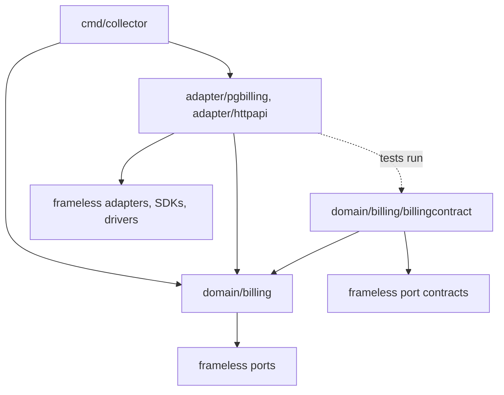

# Frameless software design

Frameless is an anti-framework. It never owns your `main`, your control flow or your package tree. Instead, it ships conventions that make hexagonal architecture and SOLID the cheap default:

- **`port/...`:** building blocks for role interfaces, a shared vocabulary such as `crud.Saver`, `pubsub.Publisher` or `guard.Locker`.
- **`<port>contract`:** the behaviour of each port, as importable test suites.
- **`adapter/...`:** suppliers that pass those contracts, including the `adapter/memory` fakes for classicist TDD.
- **`pkg/...`:** kits for the edges and cross-cutting needs: `httpkit`, `cli`, `tasker`, `env`, `logger`, `errorkit`, `resilience`.

This skill covers the shape of an application built with them: the principles, where code lives, how `main` wires it, and how it is tested. For a single dependency, use the specialised skills:

| Task | Skill |
| --- | --- |
| a dependency: role interface, domain contract, fakes, discovering ports | `frameless-ports` |
| entity storage (repositories) and transactions | `frameless-crud` |
| long-running, replay-safe processes | `frameless-workflow` |
| command-line entrypoints | `frameless-cli` |
| retries, polling, rate limits | `frameless-resilience` |

## Stop signs

If you are about to do any of these, follow this skill instead:

- A domain package that imports an adapter, a driver or SDK, `database/sql`, or an HTTP server or framework.
- Packages named after a layer or a pattern instead of a meaning: `models`, `services`, `repositories`, `interfaces`, `handlers`, `utils`, `common`, `helpers`.
- A shared `interfaces` package, or interfaces declared beside their implementation "so they can be mocked".
- A DI container, a service locator, a global registry, or an `init()` that wires dependencies.
- Business rules in `main`, in an HTTP handler, in a CLI command or in a SQL query.
- Transport or storage shapes in domain types, such as JSON DTOs, SQL rows or protobuf messages. Map them at the edge with `dtokit.Mapping` or `flsql.Mapping`. The `ext:"id"` tag is a frameless convention for entities, not a transport shape.
- Designing outwards from the database schema or a framework, instead of inwards from the use case.
- Mocks. See `frameless-ports`.

## Principles

### Hexagonal architecture

The domain sits at the centre. Everything technical plugs into it through a port, and is an adapter:

| Side | Direction | The port is | Adapters |
| --- | --- | --- | --- |
| Driven (outbound) | the domain calls out | a role interface declared in the domain | `postgresql.Repository`, `postgresql.Queue`, a payment provider client, the `memory` fakes |
| Driving (inbound) | the outside calls in | the use case's exported API | an HTTP API (`httpkit`), a CLI (`cli`), workers and schedules (`tasker`) |

- Dependencies point inward only. The domain compiles, and its specs pass, with no adapter in the build.
- Choose technology late, and keep the choice reversible. Make the use case work on verified fakes first, then add PostgreSQL, a queue or an HTTP client.

### SOLID in frameless

| Principle | How frameless applies it | Do |
| --- | --- | --- |
| SRP | A module answers to one actor: the group in the organisation that can request its change. The [layout](#why-this-split-srp) is an SRP split, keeping each actor's changes apart. `errorkit` separates errors by actor too. | Before you choose a package, ask who would request this change. |
| OCP | New behaviour arrives as a new supplier or decorator for an existing role interface, not as an edit to the domain. `cache.Cache` wraps any crud source; a `pkg/resilience` retry wraps a flaky client. | Extend at the edge and leave use cases closed. |
| LSP | An interface proves only that signatures match. The domain contract proves that every supplier, fakes included, behaves the same. | Run the contract against every supplier. |
| ISP | A role interface is small and belongs to one consumer. It is composed from fine-grained ports such as `crud.Saver` and `crud.ByIDFinder`. | Declare a role interface per consumer, never per supplier. |
| DIP | The domain owns both the role interface and its contract (`<pkg>contract`). Adapters import the domain, never the other way round. | Put the abstraction and its specification on the consumer's side. |

### Contracts invert behaviour, not just signatures

From `port/intro.md`:

> While an interface primarily aids in adhering to the Liskov substitution principle, it does not necessarily invert dependency at the behavioural level. […] these contracts facilitate dependency inversion at the behavioural level, allowing your domain layer to own and specify the behaviour.

An interface without a contract leaks. Each supplier's quirks become knowledge that every caller must carry: `sql.ErrNoRows` returned as an error, redelivery by a broker, eventual consistency in an API. With a contract, the supplier translates its quirks into the domain's terms; for example, `FindByID` returns `found == false`. You then reason about one behaviour for all repositories, queues or locks, whatever backs them, instead of one mental model per component.

The same idea goes by several names:

- **Role interface plus interface testing suite.** The interface is Martin Fowler's "role interface"; the contract is a test suite that every implementation must pass.
- **Consumer-driven contract.** Publish `<pkg>contract`, and another team's adapter runs your expectations in their CI.
- **Port plus port contract**, in hexagonal terms.

`frameless-ports` shows how to write and run them.

## Layout

### Why this split: SRP

The layout comes from the Single Responsibility Principle as Robert C. Martin defines it in *Clean Architecture*: "A module should be responsible to one, and only one, actor." An actor is a group in the organisation that can come to you and request a code change. SRP doesn't mean "a module does one thing". The goal is to reduce how many actors can reach into the same code, so that one group's request can't change behaviour that another group relies on.

| Who asks for the change | For example | Where it lands |
| --- | --- | --- |
| a business expert | collect invoices in instalments | `domain/<affected business>`, e.g. `domain/billing` |
| a database admin | partition a table, rework an index, upgrade the driver | `adapter/<that database's tech>`, e.g. `adapter/pgbilling` |
| UX, for the website | change a page's layout or a signup flow | `adapter/<front-end tech>`, e.g. `adapter/webui` |
| an upstream service's owner | the payment provider ships API v2 | `adapter/<that service>`, e.g. `adapter/stripe` |
| the security team | a new access policy, or hardening how it is enforced | `domain/security` for the policy, the involved technology's adapter for its enforcement |
| operations | a new setting, deployment topology, shutdown timeout | `cmd/<binary>` |
| the team itself | better logging, debugging or test tooling | `pkg/<topic>kit` |

- **It is never a clean cut.** Some topics touch several actors; security is the classic case. Split the change along the same line: the business decision goes to the domain, and the technology work goes to the adapter.
- **The hexagonal split is the reliable coarse cut.** Changes to the technology stack and to upstream services stay in adapters, away from the business logic, so they can't cascade into changes in system behaviour.
- **Contracts keep the cut honest.** Without one, behaviour leaks through the interface: the domain starts to depend on how a supplier happens to behave, and so gains the DBA or the provider as a hidden actor. With the domain contract, an adapter change that would alter behaviour the domain relies on fails in the adapter's own tests, instead of reaching the domain.

### Directory structure

The default for an application module. Adapt the names, but keep the dependency rules:

```text
example.com/app/
├── cmd/
│   ├── api/main.go           # one composition root per deliverable
│   └── collector/main.go
├── domain/
│   └── billing/              # one package per bounded context
│       ├── billing.go        # entities, use cases, role interfaces, domain errors
│       ├── billing_test.go   # use-case specs on verified fakes (package billing_test)
│       └── billingcontract/  # behaviour every supplier of billing's role interfaces must pass
├── adapter/
│   ├── httpapi/              # driving: HTTP → billing use cases
│   ├── pgbilling/            # driven: PostgreSQL → billing role interfaces
│   ├── stripe/               # driven: payment provider → billing.PaymentGateway
│   └── inmemory/             # driven: fakes for domain-specific ports
└── pkg/
    └── tracekit/             # the team's own tooling, no business rules
```

| Directory | Holds | Actors who request changes | May import | Must not import |
| --- | --- | --- | --- | --- |
| `domain/<context>` | entities, value objects, use cases, role interfaces, domain errors | the business experts of that context | stdlib, `frameless/port/...`, technology-free kits (`errorkit`, `logger`, `iterkit`, `testcase/clock`), packages of the same context | `adapter/...`, drivers, SDKs, other bounded contexts |
| `domain/<context>/<context>contract` | one contract function per role interface, plus `Config` | the same business experts, through what the domain expects of its suppliers | its domain package, port contracts, `testcase` | any supplier |
| `adapter/<name>` | suppliers of role interfaces; driving adapters that translate a transport into use-case calls | whoever owns its technology or upstream service (DBA, UX, provider), plus new domain needs | the domain packages it serves, frameless adapters and kits, SDKs, drivers | business rules, `cmd` |
| `cmd/<binary>` | `main` and `Main(ctx) error`: configuration, construction, wiring, lifecycle | operations: deployment and integration | anything | business rules |
| `pkg/<topic>kit` | the team's own tooling: logging, debugging, test and manual-testing helpers | the team itself, for a better developer experience | stdlib, frameless | `domain`, `adapter` |

- **Naming.** Name packages by what they're about: the bounded context (`billing`), technology plus context for driven adapters (`pgbilling`), or the transport for driving adapters (`httpapi`). Helper packages get the `kit` suffix, never `util` (frameless ADR `docs/ADR/package-name-suffix.md`).
- **Fakes are adapters.** They live in `adapter/` and run the same contract as the real supplier. Domain specs, other contexts' specs and local runs can all use them. For frameless ports, use `go.llib.dev/frameless/adapter/memory` instead of writing your own.
- **Domain specs** live in the external test package (`package billing_test`), so they can import fakes that import the domain.
- **Bounded contexts don't import each other.** When one needs another, declare a role interface and supply it with an adapter that calls the other context. Alternatively, connect them with events (`pubsub`).
- **Start small.** A service with one context has a single `domain/` package. Don't create empty layers. Nest the tree under `internal/` if other modules must not import it. In a library such as frameless itself, `port/` takes the place of `domain/`.



## Composition root

`cmd/<binary>` is the only package that knows which supplier plays which role.

- `main()` builds the base context, calls `Main(ctx) error` and reports a failure with `logger.Fatal`. Because `Main` returns errors instead of exiting, deferred cleanup runs and it can be tested.
- `Main` works in this order:
  1. It loads configuration with `env.Load(&cfg)` into a struct with `env:"…"` tags, plus `default:"…"` and `required:"true"`.
  2. It opens shared resources, such as one `postgresql.Connection` for every PostgreSQL supplier.
  3. It builds the suppliers and runs their migrations.
  4. It assembles the use cases with struct literals, assigning the suppliers to role-interface fields.
  5. It builds the driving adapters around the use cases.
  6. It runs them with `tasker.Main`. This stops on SIGINT or SIGTERM, and cancels the other tasks when one fails.
- Wire by hand. Struct literals and the compiler are your DI container: a missing method or a wrong type is a build error, not a runtime surprise.
- One supplier may satisfy several role interfaces, and a role interface may have a different supplier in each binary.

From `examples/ports-and-adapters/cmd/collector/main.go`:

```go
func main() {
	ctx := logging.ContextWith(context.Background(), logger.Field("app", "collector"))
	if err := Main(ctx); err != nil {
		logger.Fatal(ctx, "collector failed", logging.ErrField(err))
	}
}

type Config struct {
	DatabaseURL string `env:"DATABASE_URL" required:"true"`
}

func Main(ctx context.Context) (rErr error) {
	var c Config
	if err := env.Load(&c); err != nil {
		return err
	}
	conn, err := postgresql.Connect(c.DatabaseURL)
	if err != nil {
		return err
	}
	defer errorkit.Finish(&rErr, conn.Close)

	events := postgresql.Queue[billing.InvoiceIssued]{Table: "billing_invoice_issued", Connection: conn}
	if err := events.Migrate(ctx); err != nil {
		return err
	}
	locks := pgbilling.InvoiceLocks{Connection: conn}
	if err := locks.Migrate(ctx); err != nil {
		return err
	}

	collector := billing.Collector{
		Events:  events,
		Locks:   locks,
		Gateway: &inmemory.PaymentGateway{}, // the example has no payment provider
	}
	return tasker.Main(ctx, collector.Collect)
}
```

`tasker.Main` is generic over a single task type. To run different kinds of task together, convert them to `tasker.Task`:

```go
return tasker.Main(ctx,
	tasker.HTTPServerTask(srv),
	tasker.ToTask(collector.Collect),
)
```

- `tasker.WithShutdown(start, stop)` handles servers that have no ready-made task.
- `tasker.WithRepeat(tasker.Every(d), task)` handles polling loops.
- `tasker.OnError(task, handler)` logs and recovers instead of stopping the process.
- `tasker.Scheduler` runs scheduled jobs. Its suppliers are listed in the `frameless-ports` catalogue.

## Driving adapters

Driving adapters translate; they don't decide. Each one parses input, calls one use case, and maps the result and the errors back.

- **HTTP**, as in `examples/restful-api/adapter/httpapi`:
  - A `Config` struct holds what the API drives: use cases or, for plain CRUD resources, the repository role interfaces.
  - `NewServer(Config) (*http.Server, error)` builds an `httpkit.Router` with `httpkit.RESTHandler` resources. For a repository, use `httpkit.RESTHandlerFromCRUD`.
  - `dtokit.Mapping` converts between entities and DTOs.
  - An `rfc7807.Handler` maps domain errors to problem responses.
  - `main` runs it with `tasker.HTTPServerTask(srv)`.
- **CLI:** see `frameless-cli`. The commands and `NewMux(deps…)` live in an importable package; `main` wires them and calls `cli.Main`.
- **Workers:** a use-case method shaped `func(context.Context) error`, like `billing.Collector.Collect`, is already a task, so `main` hands it to `tasker`.
- **Errors:** the domain declares its errors as constants, such as `const ErrNotFound errorkit.Error = "…"`. Use `errorkit.UserError{Code, Message}` for errors the end user must see. The adapter chooses the status code or the exit code.

## Transactions across suppliers

- **A transaction travels in `ctx`.** A use case that must change several things atomically depends on a `comproto.OnePhaseCommitProtocol`, which is often the shared `postgresql.Connection`. It calls `BeginTx` and passes the returned context to every supplier involved.
- **Suppliers on the same connection join it,** and the contracts verify this: `crudcontract.OnePhaseCommitProtocol` for repositories, `pubsubcontract.TransactionalPublisher` for publishers.
- **Resources without transactions** register rollback steps with `txkit`.
- **Details:** see `frameless-crud`.

## Testing strategy

| What | Test with | Lives in |
| --- | --- | --- |
| each supplier honours its role interface | the domain contract, with `-race` | the supplier's `_test.go`, fakes included |
| use cases | specs on verified fakes (`adapter/memory`, your `adapter/inmemory`) | `domain/<context>/*_test.go` |
| driving adapters | `httptest` or `cli.ResponseRecorder` over real use cases backed by fakes | the adapter's `_test.go` |
| wiring | `go build ./...` and `go vet ./...`; optionally a smoke test of `Main` against test infrastructure | `cmd/` |

- **No mocks anywhere.** A fake that passes the contract is as trustworthy as the real supplier, as far as the domain is concerned.
- **Time and logs:** control time with `timecop` and capture logs with `logger.Stub(t)`. Inject neither.
- **Specs:** write them with `go.llib.dev/testcase`.

## Workflow

Work from the inside out: domain first, technology last.

1. Find the bounded context and the use case. Name things in the domain's language.
2. Write the use case in `domain/<context>`, against role interfaces for what it needs. See `frameless-ports`, and `frameless-crud` for storage.
3. Write `<context>contract`, and make the fakes pass it.
4. Specify the use case on those fakes.
5. Add the driving adapter: HTTP, a CLI or a worker.
6. Wire everything in `cmd/<binary>`.
7. Add the real suppliers in `adapter/`, each running the contract, and swap them in `cmd`. Nothing in `domain` should change. If it must, the role interface was leaking technology.

To review import direction, list each package's direct imports:

```sh
go list -f '{{.ImportPath}}: {{join .Imports " "}}' ./domain/...
```

## Reference

These examples live in the frameless repository. Each is a separate module, so it isn't in the module cache. Online: https://github.com/adamluzsi/frameless/tree/main/examples

- **`examples/ports-and-adapters`:** domain, contract, fake, PostgreSQL suppliers, and the `cmd/collector` composition root.
- **`examples/restful-api`:** `cmd/restapi`, then `adapter/httpapi`, then `domain/mydomain`, using `httpkit`, `dtokit` and `rfc7807`.
- **`examples/background-processing`:** an HTTP publisher and a queue consumer in one `tasker.Main`.
- **`examples/cli-app`:** a CLI entrypoint.

Frameless's own rationale is in `README.md` (port, adapter and pkg), `port/intro.md` (behavioural DIP) and `docs/ADR/`.

## Checklist

- [ ] Each package answers to one actor: you can name the group that would ask to change it. Its name says what it's about, not which layer or pattern it implements.
- [ ] `domain` imports no adapter, driver, SDK or other bounded context.
- [ ] Every role interface lives with its consumer, and has a `<pkg>contract` that every supplier runs (`frameless-ports`).
- [ ] Use-case specs run on verified fakes, without mocks or infrastructure.
- [ ] Driving adapters only translate: input, one use-case call, output and error mapping.
- [ ] `main` only calls `Main`. `Main` only configures, constructs, wires and runs (`tasker.Main`), with no business rules and no DI container.
- [ ] Swapping a supplier touches only `adapter/` and `cmd/`.
