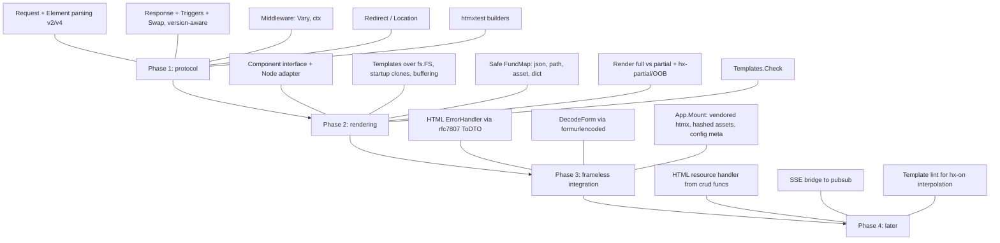

# Design implications for a frameless `htmx` adapter

> **Status: proposals.** Nothing here is implemented. Code blocks are *illustrative sketches* to make trade-offs concrete. They are not API commitments, and they haven't been compiled.
>
> Each proposal links to the finding it is based on. "Inference" marks judgement calls.

Current state of the package (`adapter/htmx`, its own module, `go 1.27.3`, requires `go.llib.dev/frameless v0.346.0`):

```go
type App struct{ MountPoint string }
func (app App) Mount(m httpkit.Multiplexer, pattern string) {}
```

## 1. Positioning

Based on [community-sentiment.md](community-sentiment.md), [landscape.md](landscape.md) and [go-htmx-helper-libraries.md](go-htmx-helper-libraries.md):

| Decision | Why |
|---|---|
| **Stdlib `html/template` first** | Biggest user base; "good enough" is the most common view; developers distrust build steps and DSLs. Its pains are ergonomic, so a library can fix them. |
| **Renderer-agnostic at the edges** | templ is the #1 third-party engine and gomponents the no-codegen alternative. A one-method `Component` interface lets both in without depending on either. |
| **htmx 4 first, htmx 2 compatible per request** | v4 is out (2026-08-28), but most tutorials and helpers are still v2, and only go-htmx supports v4, as an opt-in. Detecting the version from request headers is cheap. |
| **Plain `net/http`** | Works with Gin, chi, Echo and `ServeMux` users; fits `httpkit.Router`/`Multiplexer`. |
| **frameless-native integration** | The gap no other library fills: error mapping, crud repositories, form decoding, path building, test support. |
| **Small surface** | The niche is fragmented and the maximal approach (go-partial) has little adoption. Borrow its *checks*, not its scope. |

## 2. Request model (version-normalised)

Based on [htmx-4-server-contract.md §1](htmx-4-server-contract.md#1-request-headers).

```go
// sketch
type Request struct {
    HTMX           bool       // HX-Request: true
    Version        Version    // V4 if HX-Request-Type or HX-Source present, else V2 (when HTMX)
    Type           RequestType // Partial | Full (v4 header; v2 derived)
    Boosted        bool
    HistoryRestore bool
    CurrentURL     *url.URL   // HX-Current-URL, falls back to r.URL
    Target         Element    // v4 "tag#id" → {Tag, ID}; v2 "id" → {ID}
    Source         Element    // v4 HX-Source; v2 HX-Trigger (request)
    TriggerName    string     // v2 only
    Prompt         string     // v2 header; v4 only with the hx-prompt extension (URI-encoded)
}

type Element struct{ Tag, ID string }

func ParseRequest(r *http.Request) Request
func (r Request) IsPartial() bool // v4: HTMX && Type == Partial; v2: HTMX && !Boosted && !HistoryRestore
```

- **Value type**, parsed once by middleware and stored in ctx (`RequestFrom(ctx)`), with `ParseRequest(r)` for use without middleware. That matches the pagoda pattern and avoids go-htmx's split between versioned handler methods and v2-only package functions.
- Parse `Element` with `strings.Cut(v, "#")` + `url.PathUnescape` (v4 ids are `encodeURI`d).

## 3. Response headers

Based on [htmx-4-server-contract.md §2](htmx-4-server-contract.md#2-response-headers).

```go
// sketch
type Response struct {
    Location   *Location // path or JSON object form
    Redirect   string
    Refresh    bool
    PushURL    string    // or "false"
    ReplaceURL string
    Reswap     Swap      // rendered with v2 or v4 modifier syntax
    Retarget   string
    Reselect   string
    Trigger    Triggers  // merged into one JSON object; supports v4 "target"
}

func (resp Response) Apply(h http.Header, req Request) // version-aware; must run before WriteHeader
```

- **Value semantics** avoid the shared-builder trap of htmx-go (`Clone()` warning).
- `Triggers` merges events from several layers (handler, error handler, flash middleware) into a single `HX-Trigger` JSON value. For v2 clients, it can optionally map "after swap" intents to `HX-Trigger-After-Swap`. For v4 clients it never sends the removed headers.
- `Swap` renders v4 camelCase modifiers (`focusScroll`, `showTarget`) or v2 kebab-case.

**Inference:** a helper that stores a `*Response` in ctx would let deep code (an error handler, a use-case wrapper) add triggers without a writer. The middleware flushes it before the status is written. This composes with buffering (§5) and with `httpkit.TransactionMiddleware`, which also buffers until commit.

## 4. Middleware

```go
// sketch
func Middleware(next http.Handler) http.Handler // httpkit.MiddlewareFactoryFunc-compatible
```

1. Parses the `Request` and puts it in ctx.
2. Adds `Vary: HX-Request, HX-Request-Type` to every response, as Alex Edwards does for `HX-Request` ([stdlib-html-template.md §2](stdlib-html-template.md#2-the-canonical-stdlib--htmx-pattern-alex-edwards-2026)).
3. Optionally holds the ctx-scoped `Response` and applies it on the first `WriteHeader`.

It's usable via `router.Use(htmx.Middleware)` or `httpkit.WithMiddleware(h, htmx.Middleware)`.

CSRF stays out of the adapter. Document `http.NewCrossOriginProtection().Handler(h)` (Go 1.25+) as the recommended default. It needs no token plumbing for same-origin htmx `fetch` requests, and htmx 4 defaults to `mode: 'same-origin'` *(source)*.

## 5. Rendering: `Component` + stdlib template set

### 5.1 One interface for every renderer

```go
// sketch
type Component interface {
    Render(ctx context.Context, w io.Writer) error // same method set as templ.Component
}
type ComponentFunc func(ctx context.Context, w io.Writer) error

// gomponents (Render(io.Writer) error) via a tiny adapter, no import needed:
func Node(n interface{ Render(io.Writer) error }) Component
```

templ components satisfy `Component` structurally, so there's no templ dependency ([stdlib-html-template.md §7](stdlib-html-template.md#7-interop-with-templ-and-gomponents)).

### 5.2 Template set over `fs.FS` (the stdlib-first core)

Addresses the papercuts in [stdlib-html-template.md §3–§5](stdlib-html-template.md#3-organising-a-template-set).

```go
// sketch
type Templates struct {
    FS      fs.FS             // embed.FS in prod, os.DirFS in dev
    Funcs   template.FuncMap  // merged over the safe defaults
    Reload  bool              // dev: re-load on every render (or on change)
    // conventions (overridable): layouts/*, partials/*, pages/**
}

func (ts *Templates) Load() error                                   // parse shared set, clone per page at startup
func (ts *Templates) Page(name string, data any) Component           // full page via its layout
func (ts *Templates) Fragment(page, block string, data any) Component // {{block}} inside a page
func (ts *Templates) Check(samples map[string]any) error             // execute pages/fragments into io.Discard
```

- **Per-page clones built eagerly at startup** (strategy B). That's required because `Clone` fails after the first execution (verified), and it moves parse errors to boot time.
- **`missingkey=error`** on by default.
- **Always buffer** into a pooled buffer, apply headers, then `WriteHeader` + write. A failed render then becomes a clean error response.
- **Default funcs:** `json`, `path` (pathkit + `url.PathEscape`, rejecting `""`/`.`/`..`), `asset` (hashed URL from `App`), `dict`.
- **`Check`** turns runtime-only template errors into a startup or test failure. go-partial's `CheckTemplates` is prior art; a frameless version could stay smaller: execute what is declared and report everything.
- **Optional lint (inference, not prototyped):** walk the `text/template/parse` tree and flag `{{…}}` actions inside `hx-on*`, `x-*` and `@*` attributes that aren't wrapped in `json`.

### 5.3 Choosing page vs fragment, and multi-target responses

```go
// sketch
func Render(w http.ResponseWriter, r *http.Request, status int, full, partial Component, extra ...Partial) error

type Partial struct {
    Target string      // "#id"
    Swap   string      // optional
    Body   Component
}
```

- `IsPartial()` decides `full` vs `partial`.
- `extra` partials are emitted as `<hx-partial hx-target=… hx-swap=…>` for v4 clients. For v2 clients they become an OOB wrapper (`hx-swap-oob="innerHTML:#id"`-style; *to verify against htmx 2 OOB semantics before relying on it*).
- An optional `Title string` emits a top-level `<title>` next to the fragment, covering the [yawaramin](https://news.ycombinator.com/item?id=48915935) need without each template remembering it.
- `iter.Seq2[T, error]` from `crud.AllFinder.FindAll` can be passed straight into template data. Buffering makes mid-iteration errors safe.

## 6. Redirects

Based on [htmx-4-server-contract.md §2](htmx-4-server-contract.md#2-response-headers) (3xx headers are ignored).

```go
// sketch
func Redirect(w http.ResponseWriter, r *http.Request, url string)        // htmx: 200/204 + HX-Redirect; else http.Redirect 303
func Location(w http.ResponseWriter, r *http.Request, loc Location)      // htmx: HX-Location; else 303
```

- `Redirect` is the safe default (Alex Edwards' reasoning).
- In v4, `HX-Location` follow-ups arrive as `HX-Request-Type: full` *(source)*. So `Location` becomes safe **as long as handlers branch on `IsPartial()` and not on `HX-Request`**. Since the adapter controls that branching, `Location` can be offered without the v2 caveat. Worth stating in the docs.
- Use pathkit for building URLs.

## 7. HTML error handling

Based on [htmx-4-server-contract.md §3](htmx-4-server-contract.md#3-behaviour-changes-that-affect-server-code): v4 swaps 4xx/5xx by default.

`httpkit.ErrorHandler` is `HandleError(w, r, err)`. `rfc7807.Handler.ToDTO(ctx, err)` is exported. It turns `errorkit.UserError` into 400 + code/title/detail, otherwise 500, and then runs the `Mapping` (default `httpkit.ErrorMapping`: 404/405/409/413/403/400).

```go
// sketch
type ErrorHandler struct {
    Mapping   rfc7807.HandlerMappingFunc // default httpkit.ErrorMapping
    Page      func(dto rfc7807.DTO) Component // full-page error
    Fragment  func(dto rfc7807.DTO) Component // swappable error fragment
    Target    string                          // optional HX-Retarget for fragments, e.g. "#errors"
}

func (h ErrorHandler) HandleError(w http.ResponseWriter, r *http.Request, err error)
```

- It reuses frameless' error→status mapping exactly, so JSON (rfc7807) and HTML endpoints agree on status codes.
- **Full requests** get the error page. **Partial requests** get the fragment, plus optional `HX-Retarget`/`HX-Reswap`, so v4's default 4xx/5xx swap lands somewhere sensible.
- **Validation:** `ToDTO` maps `UserError` to **400**. The htmx community convention for "re-render the form with errors" is **422** (Alex Edwards' `responseHandling`; htmx 4 `hx-status:422`). *Open question:* add a 422 mapping for a validation error type, or let the form helper own the status.
- Context-cancelled requests are skipped, as `rfc7807.Handler` does.

## 8. Forms

- `formurlencoded.Codec{}.Unmarshal(body, &dto)` already decodes htmx form posts:
  - snake_case keys by default (`StringCase` overridable).
  - Nested keys use `.` (`a.b`) and list indexes (`items.0.name`).
- **Proposal:** a small `DecodeForm[T](r) (T, error)` that enforces a body size limit and maps decode errors to `httpkit.ErrInvalidRequestBody`, giving a 400 through the mapping above.
- No-JS fallback: plain `<form>` only does GET/POST. PUT, DELETE and PATCH need htmx (`hx-put`, …) or a method-override convention. *Open question* whether the adapter should offer an opt-in `_method` override middleware for progressive enhancement.

## 9. Relationship to `RESTHandler`

Verified in `pkg/httpkit/resthandler.go` and `port/codec`:

- `codec.Marshaler` is `Marshal(v any) ([]byte, error)`. It **receives no request or ctx**, so an "HTML codec" can't know whether the client wants a full page or a fragment, or read the htmx headers.
- `RESTHandler`'s item route handles `GET`/`HEAD`/`PUT`/`DELETE`. **`PATCH` → 405.** Collection: `GET`/`HEAD`/`POST`/`DELETE`.

**Implication (inference):** don't try to make `RESTHandler` render HTML through `Codecs`. Instead consider, later, an `htmx` resource handler that reuses the same function fields (`Index`, `Show`, `Create`, `Update`, `Destroy`, the `crud` port shapes) with HTML views and form decoding. It would live under `Router.Resource`/`Mount` next to the JSON API. Defer until the core (§2–§7) has users.

## 10. `App`: serving htmx itself (the existing `App.Mount`)

- htmx is **0BSD** licensed, and `htmx.min.js` 4.0.1 is 37,448 B (~13.4 KB gzipped), so vendoring it via `embed` is cheap and needs no CDN.
- **Proposal:** `App.Mount(m, pattern)` (via `httpkit.Mount`, which uses `http.StripPrefix` + `MountPoint`) serves:
  - `htmx.min.js` (and optionally a few extensions, such as `hx-sse`) under **content-hashed, immutable URLs** (`Cache-Control: public, max-age=31536000, immutable`).
  - An `asset`/`ScriptTag` helper that templates use to get the hashed URL, so upgrades don't need cache busting by hand.
  - A config helper rendering `<meta name="htmx-config" content=…>` from a Go struct. It is JSON-encoded, so it is safe in an attribute (the `json` func finding). v4 needs few overrides ([htmx-4-server-contract.md §4](htmx-4-server-contract.md#4-default-client-configuration-for-an-htmx-4-app)).
- *Open questions:* which htmx version(s) to vendor and how to track upgrades, and whether to bundle extensions or leave them to users.
- *Note:* `App.Mount` currently has a value receiver; if `App` will hold computed state (hashes, file index), a pointer receiver or a constructor may be needed.

## 11. Test support: `htmxtest`

Fits frameless' testcase/`httptest`, no-mocks style:

```go
// sketch
req := htmxtest.NewRequest(http.MethodGet, "/users?q=ad",
    htmxtest.V4(), htmxtest.Partial(), htmxtest.Target("tbody", "rows"), htmxtest.Source("input", "search"))
rr := httptest.NewRecorder()
handler.ServeHTTP(rr, req)

res := htmxtest.ParseResponse(rr) // parsed HX-* headers, triggers as map, partials split out
assert.Equal(t, "users-updated", res.Triggers.Names()[0])
```

- Builders for v2 and v4 header sets (boosted, history restore, `full`/`partial`). They make the version matrix cheap to test.
- A helper to run `Templates.Check` in a test.
- A contract-style test (`htmxcontract`?) could check that a handler honours the checklist in [htmx-4-server-contract.md §5](htmx-4-server-contract.md#5-server-checklist-v2-and-v4): `Vary` set, no 3xx with `HX-*`, pushed URLs render full pages. *Inference:* it would be the frameless-flavoured differentiator.

## 12. Later: SSE

- htmx 4 SSE is the `hx-sse` extension; Datastar is SSE-first.
- A small SSE writer (`text/event-stream`, flush, event/data framing, ctx cancellation) fed from frameless pub/sub ports could serve htmx `hx-sse` now and Datastar-style patches later. Defer.

## 13. Non-goals

- No HTML component DSL or Go-builder syntax (templ and gomponents exist; integrate, don't compete).
- No hard dependency on templ, gomponents or any router framework.
- No Node/npm/bundler step; no Tailwind integration.
- No library-owned partial trees, localisation, flash messages or metrics (go-partial's sprawl).
- No Datastar or WebSocket protocol support in v1.

## 14. How this differs from donseba/go-htmx

| | go-htmx | Proposed frameless adapter |
|---|---|---|
| htmx 4 | opt-in per instance; package funcs stay v2 | default; version detected **per request** |
| Request API | methods on a per-request handler object | immutable value parsed once; ctx-accessible |
| Templates | components over `html/template` | conventions + startup clones + checks + safe funcs + fragments/partials |
| Errors | none | `httpkit.ErrorMapping`-consistent HTML error pages and fragments |
| Data | none | `crud` `iter.Seq2` into templates; `formurlencoded` forms; `pathkit` URLs |
| Testing | none | `htmxtest` request builders, response parsing, template checks |
| Security | none documented | `json`/`path` funcs, `hx-on` escaping guidance, CrossOriginProtection docs |

## 15. Suggested phasing



## 16. Open questions for the maintainer

1. **Version policy:** support htmx 2 clients indefinitely, or for a deprecation window?
2. **Vendoring:** ship `htmx.min.js` inside the module (which version, how upgraded), or only provide the mount/asset mechanism for user-supplied files?
3. **Validation status:** 400 (current `rfc7807` behaviour for `UserError`) or 422 for form re-renders? Should a dedicated validation error type map to 422 in `httpkit.ErrorMapping`?
4. **Template conventions:** fixed directory names (`layouts/`, `partials/`, `pages/`) or configurable globs? Which define-name scheme (`page:content`, `content`, …)?
5. **Per-request template data:** a standard view-model wrapper (`{{.Request}}`, `{{.Data}}`, `{{.CSRF}}`), or leave data shape fully to users?
6. **Ctx-scoped `Response`:** worth the middleware coupling, or keep header writing explicit in handlers?
7. **Scope of `App`:** only static htmx serving, or also the composition point for middleware, error handler and templates (a mini "app" object)?
8. **HTML resource handler (§9):** desired at all, or should HTML endpoints always be hand-written handlers on `httpkit.Router`?
