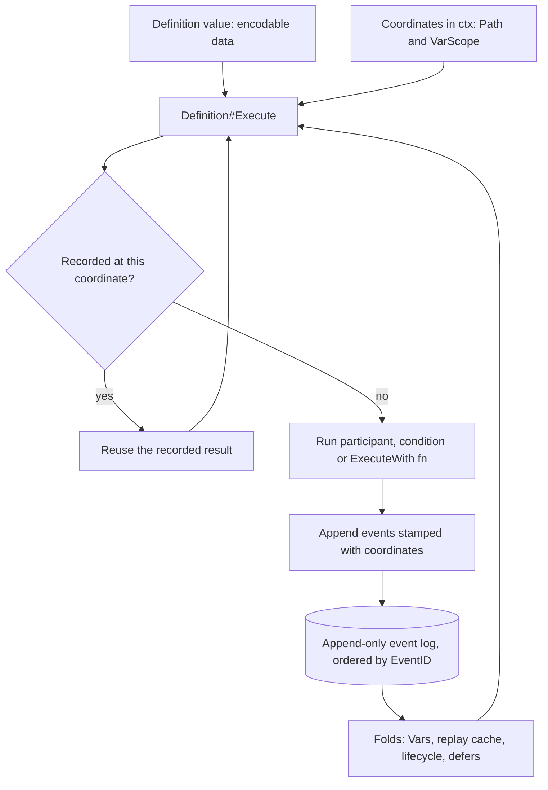

# Mental Model

This document is for people who **change or extend** the `workflow` package:
new built-in definitions, runtime features, adapters, or fixes. The per-feature
docs explain *what* each piece does. This one explains *how the package thinks*,
so that a new solution is expressed in the package's own idioms.

A change can be correct and still be foreign. For example, you could give every
`EventSetVar` a `DeclarationEventID` so that it points at the declaration it
assigns. It would work. But nothing else in the package links events to other
events. Everything else identifies a fact by **where it was recorded** and
**which binding it applies to**, and relies on the **order of the log** to
interpret it. A second identity scheme doubles the ways a fact can be
interpreted, and every fold, replay guard, codec and adapter contract would have
to learn it.

When you face a new problem, the native answer is almost always this:

> Record a fact at a coordinate, and derive everything else by folding the
> ordered log.

---

## The model in one picture



Every execution of a process, whether it is the first run, a retry, a resume
after `Suspend`, or crash recovery, walks the **same definition** with the
**same coordinates**. Whatever is already in the log is reused, and only the
missing tail is appended.

---

## 1. The event log is the only state

- **Append-only.** `EventRepository` (`runtime.go`) is a `Creator`, a
  `FindByProcessID` reader and a transaction protocol. There is no `Update` or
  `Delete`, and there is no "status" row to maintain. Undoing moves forward:
  `Replace` with a compensating definition.
- **Definitions are stateless.** A `Definition` value holds no per-process
  state. `Vars` is not a store: it is a fold over the process's events
  (`foldVars` in `vars.go`).
- **Order is creation order, and `EventID` is its authority.** `EventID` is a
  UUIDv7 (`MakeEventID`), so it sorts in creation order. Timestamps are written
  to agree with it, and `EventRepository#FindByProcessID` returns events by
  timestamp, ascending. The variable fold still re-sorts by `EventID`
  (`sortEvents` in `workflow.go`), because timestamps can tie under a coarse or
  frozen clock. New order-sensitive code should do the same.
- **"Done" is an event, not a flag.** A step is done because a success event
  exists at its `Path`. You never mark it done separately.

**Idiom:** if you need to know something later, record it as an event now, at a
coordinate that you can reconstruct deterministically later.

**Foreign:** caches in a struct, `sync.Map`s keyed by `ProcessID`, a "step
status" table, sorting by `Timestamp`, or editing or deleting events to change
an outcome.

---

## 2. Identity comes from coordinates, not from references

No event references another event's ID. Facts are correlated only by
coordinates:

| Coordinate  | Answers                                   | Comes from                                         |
| ----------- | ----------------------------------------- | -------------------------------------------------- |
| `ProcessID` | Which process                             | Caller-owned, `Bind`/`Execute` argument            |
| `Path`      | **Which step / which execution** of it    | `WithName` segments accumulated in `ctx`           |
| `VarScope`  | **Which variable binding** a fact targets | `WithVarScope` segments accumulated in `ctx`       |
| `Name` / ID | Which variable / participant / condition  | The definition's own data                          |

`Path` and `VarScope` are both `pathNode` chains carried in `context.Context`
(`path.go`). They are **deliberately independent**:

- One scope can be visited by many executions. A `For`'s loop scope is shared
  by its `init`, and by the `cond` and `post` of every round, each on a path
  of its own (`for/init`, `for/[n]/cond`, `for/[n]/post`).
- One execution can target a scope other than its own. An `Increment` inside a
  loop records its event at the loop body's path, against the binding in the
  root scope.

The coordinates are derived, never stored on the definition. A child cannot
know its position, and doesn't need to: the parent puts it in `ctx`.

### Roots

- **Path root:** the `EventUseDefinition.EventID` of the active binding
  (`Runtime.execute`, `WithName(ctx, def.EventID.String())`). A `Replace`
  therefore re-roots every step path, so the new definition starts fresh.
- **VarScope root:** empty. *Derived from code, not covered by a dedicated
  test:* variables in the root scope survive a `Replace`, because the scope,
  unlike the path, is not re-rooted. The scopes the built-ins open are named
  after paths (see below), so a new definition never reopens a scope of the
  one it replaced.

### Segments contributed by the built-ins

| Definition           | Path segments                              | VarScope segments       |
| -------------------- | ------------------------------------------ | ----------------------- |
| `Sequence`           | `sequence/[i]`                             | —                       |
| `If`                 | `if/then`, `if/else`                       | —                       |
| `For`                | `for/init`, `for/[n]/cond`, `…/do`, `…/post` | the loop's block, then `[n]` for the `do` of each round |
| `ForEach`            | `[i]` or `%v` of the map key               | the iteration's block   |
| `Sleep`              | `sleep/<unix-second>` (for the condition)  | —                       |
| `Execute` (and `…With`) | `<ParticipantID or ConditionID>`        | —                       |
| `SetVar` / `DeclareVar` / `DeleteVar` / `Increment` | `set-var` / `declare-var` / `delete-var` / `inc-op` | — |
| `Defer`              | `defer`, then `<EventDefer.EventID>` when run | `<EventDefer.EventID>` when run |
| `Spawn`              | `spawn/<SpawnName>`                        | —                       |
| `Join`               | `join[/<SpawnName>]`                       | —                       |

**A block's scope is named after its path.** Like every block in Go, the body
of a loop gets a variable scope of its own on every execution: each `ForEach`
iteration, and the `do` of each `For` round. The loop clause of a `For` gets
one too. The built-ins name such a scope after the block's path, relative to
the path where the enclosing scope was opened (`openVarScope` in `path.go`).
That keeps one segment per scope, and makes the scopes exactly as distinct as
the paths: two sibling loops, or two rounds of a loop, never share a scope,
while a replay of the same block gets the very same one. For example,
`Sequence{SetVar, ForEach, For{Do: ForEach}}` opens:

```text
R/sequence/[1]/[0]                                   the first iteration of the ForEach
R/sequence/[2]/for                                   the loop clause of the For
R/sequence/[2]/for  →  [0]                           the body of its first round
R/sequence/[2]/for  →  [0]  →  do/[0]                the first iteration of the ForEach in that body
```

`WithVarScope(ctx, name)` opens a scope under the given name instead, and the
scopes opened within it are named relative to where it was opened.

**Idiom:** a composite gives every child a segment that is distinct among its
siblings and **deterministic from definition data plus recorded facts**. The
only non-structural segments in the package are recorded `EventID`s (§7) and
`Sleep`'s time bucket (§8), which is deliberately fresh.

**Foreign:** random or time-based segments (other than the deliberate `Sleep`
case), counters kept in memory, or passing a "parent step ID" field down to
children.

---

## 3. Variables are a fold keyed by coordinates

A variable event carries three coordinates:

- `Path`: where it was recorded, meaning which execution made it.
- `Scope`: which binding it applies to.
- `Name`.

Folding them in `EventID` order produces the bindings.

- **One binding per `(Name, Scope)`.** A re-declaration in the same scope
  replaces the binding (`varFold` in `vars.go`). Inner scopes shadow outer
  ones, and a deleted binding keeps shadowing.
- **Assignments are bound at write time.** `Set` and `Delete` resolve the name
  from the current scope and record the **`Scope` of the binding they
  reached**. A later declaration of the same name in a nearer scope shadows
  that binding for future reads. It can never retroactively capture earlier
  assignments. This is how the package answers "which declaration does this set
  belong to?" without a declaration ID.
- **Assigning an undeclared name declares it first.** The declaration goes in
  the current scope, or in the iteration scope for a `ForEach` K/V. The declare
  and the set are two separately idempotent events, and "declared but
  unassigned" is a valid state that a retry resumes from.
- **Replay guard = `(EventType, Path, Name)`.** The built-in variable steps use
  `setOnce`/`declareOnce`/`deleteOnce`, which skip if an event of that type for
  that name already exists at the current path (`varMutationDone`). Because
  every loop round and iteration has its own path, the same `SetVar` inside a
  loop records once per round, not once in total.
- **Derive, don't record, what can be re-derived.** `ForEach` K/V are not
  written to the log. The iteration carries a *reference* (`iterationVars`: the
  collection name and the position), and every read re-resolves it against the
  current value of the collection. No other execution of a loop body shares an
  iteration's scope, so `resolve` knows that a visible declaration in that
  scope, or in one nested in it, was made within *this* iteration.

### Worked example

```go
workflow.Sequence{
    workflow.SetVar{Name: "total", Value: 0},                          // sequence/[0]
    workflow.ForEach{Over: "orders", V: "order", Do: workflow.Sequence{ // sequence/[1]
        workflow.SetVar{Name: "status", Value: "seen"},
        workflow.Increment{Name: "total"},
    }},
}
```

With `R` as the binding's `EventID` and two orders, the log records:

| # | Event       | Path                                         | Scope                | Name     |
| - | ----------- | -------------------------------------------- | -------------------- | -------- |
| 1 | DeclareVar  | `R/sequence/[0]/set-var`                     | *(root)*             | `total`  |
| 2 | SetVar `0`  | `R/sequence/[0]/set-var`                     | *(root)*             | `total`  |
| 3 | DeclareVar  | `R/sequence/[1]/[0]/sequence/[0]/set-var`    | `R/sequence/[1]/[0]` | `status` |
| 4 | SetVar      | `R/sequence/[1]/[0]/sequence/[0]/set-var`    | `R/sequence/[1]/[0]` | `status` |
| 5 | SetVar `1`  | `R/sequence/[1]/[0]/sequence/[1]/inc-op`     | *(root)*             | `total`  |
| 6 | DeclareVar  | `R/sequence/[1]/[1]/sequence/[0]/set-var`    | `R/sequence/[1]/[1]` | `status` |
| 7 | SetVar      | `R/sequence/[1]/[1]/sequence/[0]/set-var`    | `R/sequence/[1]/[1]` | `status` |
| 8 | SetVar `2`  | `R/sequence/[1]/[1]/sequence/[1]/inc-op`     | *(root)*             | `total`  |

How to read it:

- Rows 5 and 8 are recorded deep inside an iteration. Their `Path` says so, but
  they apply to the root binding, which is what their `Scope` says.
- `status` is a different binding per iteration.
- A replay walks the same paths, finds each event at its path, and appends
  nothing.

### Direct `Vars` calls from definition code

`Vars#Set` and `Vars#Delete` are **not** path-guarded. They only skip when the
value is unchanged. That is right inside a participant or an `ExecuteWith`
function: the enclosing recorded call is the guard, because once it succeeds
the function is not called again. In plain definition code, a value that can
differ between attempts, such as a timestamp, a duration or anything read
live, appends a new `EventSetVar` on every replay. Compute such values inside
a recorded step. Use the built-in `SetVar`/`DeclareVar`/`DeleteVar` steps when
you need path-guarded writes from composition code.

---

## 4. A definition is encodable data that names its own coordinates

A `Definition` should be expressible as data that can go over the wire, be
stored, be produced by an end-user builder, and be decoded years later.

- **Name capabilities; don't hold them.** Refer to a participant or condition
  by `ParticipantID`/`ConditionID`. Take dependencies from `ctx` (see
  `ContextSetup`), never from struct fields holding clients, funcs or
  channels.
- **`Execute` starts by claiming its coordinate.** The first line is
  `ctx = WithName(ctx, "<own-name>")`. Add `WithVarScope(ctx, "<name>")`
  only if the definition introduces bindings that must not leak to the caller.
  The scope gets exactly that name, so every execution under the same
  enclosing scope that uses the same name shares it; name it after something
  that tells those executions apart, like a round or an item.
  `wfcontract.Definition` asserts that children receive a non-empty path and
  that re-execution appends nothing.
- **Children get distinct, deterministic segments** (§2).
- **Register a namespaced codec tag.** Built-ins use `workflow::<name>` for
  definitions and `workflow::event::<name>` for events (`wfjson.NewCodec`).
  Custom code uses its own namespace (`acme::…`).
- **Validate from data.** Invalid data returns `ErrFatal`/`ErrInvalidDefinition`
  (not retried), via `validate.Validatable` when it can be checked up front.
- **Control flow is re-derived, not remembered.** For example, `Break` is a
  `Definition` evaluated against variables, not a runtime signal with its own
  record.

**Foreign:** closures in definitions, definition fields that change during
execution, runtime special-cases for one definition type (the runtime only
knows `Definition#Execute` and ctx), or a definition that reads its own
position from a field instead of from `ctx`.

---

## 5. One recording primitive: the idempotent executor

Everything that must happen once per coordinate goes through
`idempotentExecutor` (`idempotent.go`). Its public faces are:

- `Execute` with a `Participant` or `Condition`,
- `Execute#ExecuteWith` (your own step logic under a `ParticipantID`),
- `Execute#EvaluateWith` (your own condition under a `ConditionID`).

For example, `wftemplate.Condition` has no recording logic of its own. It is
just `EvaluateWith` under the fixed ID `template-condition`.

Its rules:

- **A cache hit** needs the same ID at the same `Path`, the same input values
  (as the history saw them at that point), and matching input/output arity.
- **Only success is recorded.** A genuine failure rolls back the call's events,
  and an `EventError` is written in a *sibling* transaction for audit
  (`recordErrorEvent`). A signal is neither a success nor a failure: it leaves
  no call record.
- **Transactions nest.** The events of a call and of the calls made inside it
  commit together (`commitEventsTx`). Signals commit what was recorded before
  them. Ordinary errors roll it back.

**Idiom:** a new feature that needs "do this once and remember the answer"
reuses `ExecuteWith`/`EvaluateWith` under a stable, namespaced ID.

**Foreign:** a new event type plus a hand-written "have I done this?" lookup
for something the executor already models.

---

## 6. Participants: one idempotent effect, or a definition of them

A participant should do exactly one of two things:

1. **Perform one idempotent effect** and return `nil` (plus outputs). The
   success event is its "done" marker.
2. **Return a `Definition`** of steps, each of which is idempotent on its own.
   The returned definition is recorded with the call and, on every later pass,
   walked again under the call's path. Finished steps replay, and the first
   unfinished one continues. The tree grows by appending, never by editing.

Why not do A, B and C inside one participant? If it fails after B, nothing is
recorded, so the whole participant runs again from A. There is no coordinate
for "A and B are done", so recovery must be hand-built inside the participant.
Returning `Sequence{Execute A, Execute B, Execute C}` gives each piece its own
coordinate and record.

Caveats that belong to the model:

- A returned definition runs **inside the producer's transaction**. An ordinary
  failure deep inside can roll back the producer's record and its earlier
  nested successes. If you need independent commit boundaries, use top-level
  `Sequence` steps.
- **Orchestrate, don't bundle.** Mint shared values such as idempotency keys and
  IDs in their own recorded step, before the steps that use them
  (`participant.md`).
- Recording a result is not exactly-once for external effects. Use business
  idempotency keys.

---

## 7. A recorded event's ID roots the definition it carries

When an event carries a definition to run later, that event's `EventID` becomes
the coordinate segment for it:

- `EventUseDefinition.EventID` is the root `Path` segment of the binding.
- `EventDefer.EventID` is appended to both the `Path` and the `VarScope` when
  the deferred definition runs (`EventDefer#Context` in `defer.go`).
  Registration is deduplicated by the `(Path, VarScope)` where `Defer` ran.
- A participant's returned definition is walked under the recorded call's path.

This is the one sanctioned way to get a unique yet replay-stable segment: it is
unique because it is an ID, and stable because it has been recorded.

**Foreign:** generating a fresh UUID for a segment at execution time. It would
differ on every replay.

---

## 8. To get a different answer, move to a different coordinate

A recorded answer is final at its coordinate. When the semantics call for
asking again, the package varies the **path**. It never deletes or edits the
old answer.

- `Sleep` evaluates its condition under `sleep/<unix-second>`, so each attempt
  asks anew. The wake-up is recorded as `EventSleepCompleted` at the `Sleep`'s
  own path, so a woken `Sleep` stays woken on replay.
- `Replace` changes the definition by appending a new `EventUseDefinition`,
  which re-roots every path (§2).
- Loop rounds and iterations get new paths, so the same body records anew per
  round (§3).

---

## 9. Signals are control flow, not errors

`RuntimeSignal`s (`Suspend`, `Halt`, `Replace`, `Complete`, `Terminate`) travel
through the `error` channel, but they are not failures.

- They are detected by a plain **type assertion** (`isRuntimeSignal`), so
  **never wrap them**.
- They are not retried and do not roll back what was recorded before them.
- `Suspend`/`Halt` leave no call record, so the signaling step is asked again
  on the next attempt. Keep the work before a signal cheap and side-effect
  free.
- `Replace` is recorded as a new binding (§8).

Non-signal errors are classified by what the runtime should do:

- `ErrFatal`/`ErrInvalidDefinition`: no retry, the message is dropped.
- A missing participant or a signature mismatch is an **availability**
  problem. Work is preserved and the process is requeued while a compatible
  deployment rolls out.
- Everything else goes to `RetryStrategy`.

**Idiom:** new "stop, pause or redirect" behavior is a signal or a definition,
not an error string to match on. If the behavior can be re-derived from state,
prefer a definition (as with `Break`).

---

## 10. Budgets are cooperative and stop only at progress boundaries

The execution TTL never interrupts a step halfway.

- The runtime suspends only **after** fresh progress has been recorded.
- Cached replays never trigger a suspend.
- Nested fresh activities finish before the budget yields (`ctxTTL.Active` in
  `context.go`).

This keeps "what was committed" aligned with "what the log says is done."

---

## 11. The caller owns identity, and the log owns lifecycle

- **The caller mints the `ProcessID`** and can therefore make `Bind`
  idempotent. `Bind` on an already bound process is a no-op.
- **Lifecycle outcomes are events** (`EventCompleted`, `EventTerminated`), not
  fields.
- **Deferred definitions run LIFO** before the outcome is recorded.
- **Child processes are identified by `SpawnName`** within the parent, which is
  what `Join` addresses.

---

## 12. Ports are role interfaces with executable contracts

The runtime talks to small role interfaces (`EventRepository`, `Queue`,
`NotificationBroadcast`, `ProcessLocks`, `Codec`, the registries). Each one has
a contract suite in `wfcontract` that states its behavior as tests.

- To add a capability to a port, extend its contract first. Every adapter must
  then prove the new behavior.
- To depend on a new external behavior, add a role interface and a contract.
  Don't type-assert to a concrete adapter.

---

## 13. Evolve by appending

Recorded histories outlive the code that wrote them.

- **Paths are positional.** Inserting or reordering steps in a bound
  definition, or in a code-built child tree, shifts every later path and breaks
  replay of existing processes. Append instead, or ship the change as a new
  binding through `Replace` or a migration.
- **Changing a built-in's segments is a breaking change** for every stored
  history, however cosmetic it looks.
- **Wire tags are forever.** Keep old tags decodable with
  `jsonkit.CodecRegisterMigration` (see the legacy `workflow::participant` and
  `workflow::condition` in `wfjson.go`). Keep old Go shapes as adapters in the
  `deprecated` package.
- **The `internal/compatibility-promise` fixtures are never edited.** If a
  change needs them edited, the change breaks the promise.

---

## Checklist: adding a built-in or custom `Definition`

1. It is a plain value type. Every field is data, and it has an `Error()`
   name.
2. `Execute` begins with `WithName`, plus `WithVarScope` if it introduces local
   bindings.
3. Each child gets a distinct, deterministic segment.
4. Anything non-deterministic (time, randomness, I/O) happens inside
   `ExecuteWith`/`EvaluateWith` or a participant.
5. Variable writes from composition code go through the path-guarded steps
   (§3).
6. Signals are returned unwrapped, and invalid data is `ErrFatal`.
7. It is registered in the codec under a namespaced tag, with a DTO if the
   shape may diverge.
8. `wfcontract.Definition` passes: re-execution appends nothing, and children
   see a non-empty path.

## Foreign solution → native solution

| Tempting solution                                          | Native idiom                                                                 |
| ---------------------------------------------------------- | ---------------------------------------------------------------------------- |
| `DeclarationEventID` on `EventSetVar`                      | Record the `Scope` of the binding the name resolved to; fold in `EventID` order |
| "Step status" field or table                               | A success event at the step's `Path` is the status                           |
| In-memory cache or `sync.Map` per process                  | An event plus a fold, or `ExecuteWith`                                       |
| Update or delete an event to change an answer              | Ask at a new coordinate (`Sleep`) or `Replace` with compensation             |
| Sort or decide by `Timestamp`                              | Sort by `EventID` (UUIDv7)                                                   |
| Parent-ID field passed to children                         | The parent adds a `WithName` segment to `ctx`                                |
| Fresh UUID as a path segment                               | A *recorded* event's `EventID` as the segment (§7)                           |
| Participant doing A, B, C internally                       | Return `Sequence{Execute A, Execute B, Execute C}`, or split at top level    |
| New "run once" mechanism for custom logic                  | `Execute#ExecuteWith` / `Execute#EvaluateWith` under a stable ID             |
| `fmt.Errorf("…: %w", workflow.Suspend{})`                  | Return the signal as is                                                      |
| Client, func or channel field on a definition              | Capability ID plus dependencies from `ctx`                                   |
| Insert a step into a bound definition                      | Append, `Replace`, or migrate                                                |
| Record the ForEach element per iteration                   | Keep a reference and re-resolve it (`iterationVars`)                         |

---

## Known deviations: don't copy these

These are places where the current code or docs don't fully follow the model.
Treat them as open questions. Don't use them as precedent, and don't "fix" them
without a migration story (§13).

- **A fixed `WithVarScope` name is shared.** The built-ins name the scopes
  they open after the block's path (§2), but `WithVarScope(ctx, name)` takes
  the name as given. So the sibling instances of a custom definition that use
  the same name share a scope, and so do its repeated executions within the
  same enclosing scope, like the rounds of a loop.
- **A deferred definition doesn't see `ForEach` iteration variables.** The hook
  runs from the `Path` and `VarScope` recorded in its `EventDefer`, and the
  iteration variables are not recorded (§3), so a `Defer` in a `ForEach` body
  can't refer to `K` or `V` by the time it runs. It does see the variables the
  iteration declared, so assigning the iteration variable to one of those
  first, for example through a participant's `Output`, works.
- **`ForEach` contributes no `foreach` path segment.** Every other composite
  names itself. `ForEach` adds only `[i]` or the key.
- **The `varMutationDone` comment** describes a `(Path, Name, Scope)` triplet,
  but the code matches `(EventType, Path, Name)`.
- **Tags vs `Error()`.** `custom-definition.md` says a codec tag must match
  `Error()` byte-for-byte, but the built-ins don't follow this. For example,
  `SetVar.Error()` is `workflow::set-var` while its tag is
  `workflow::var::set`, and `Spawn.Error()` is `workflow::signal::spawn` while
  its tag is `workflow::spawn`. Event `EventType()` strings also differ from
  their `workflow::event::…` wire tags. The wire tag is the compatibility
  promise.
- **The `Timed` example in `custom-definition.md`** calls `Vars#Set` with
  `time.Since(...)` from plain definition code. Per §3, each replay appends a
  new `elapsed` event. This was observed across one `Suspend`/resume: two
  `elapsed` events. The skill's copy records the clock reads inside
  `ExecuteWith` instead.
- **Not everything orders by `EventID`.** `Runtime.execute` picks the active
  binding by `Timestamp`, and `Defer` unwinds in repository (timestamp) order.
  Both rely on timestamps agreeing with creation order.
- **`Spawn` identity is per process, not per path.** This is by design for
  `Join`, but a `Spawn` inside a loop body spawns only once.

---

## Where to go next

- [Glossary](./glossary.md): vocabulary
- [Definitions](./definition.md) and [Custom Definitions](./custom-definition.md): authoring
- [Variables](./vars.md): scope rules in detail
- [Participants](./participant.md): return values, transactions, follow-ups
- [Signals](./signal.md): per-signal persistence and retry
- [Codec](./codec.md): wire format and migrations
- [Testing](./testing.md): `wftest` and `wfcontract`
